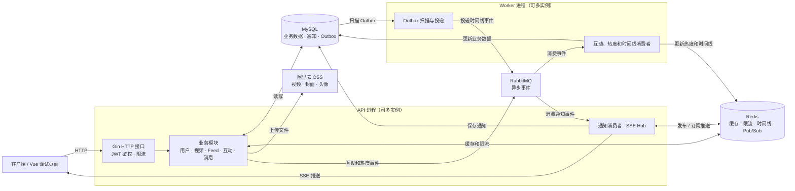

# GoVideo

GoVideo 是一个基于 Gin + Gorm 的短视频 Feed 流后端系统，支持用户注册登录、视频发布、Feed 流、热门榜、点赞评论、关注关系、消息通知、对象存储上传、集成测试和性能压测等能力。

项目重点围绕后端工程化场景设计：多级缓存、缓存击穿保护、滑动窗口限流、RabbitMQ 异步解耦、Outbox 可靠投递、消费幂等、SSE 分布式通知推送、OSS 对象存储、集成测试与 k6 性能测试。

## 技术栈

```text
语言与框架：Go, Gin, Gorm
数据库：MySQL
缓存与分布式能力：Redis, go-cache, singleflight
消息队列：RabbitMQ
对象存储：阿里云 OSS
实时推送：SSE, Redis Pub/Sub
测试：go test, miniredis, Docker Compose, k6
前端调试：Vue3
```

## 核心能力

- 基于 JWT + Redis + MySQL 实现登录鉴权、登出、token 主动失效和单点登录。
- 基于 Redis + Lua 实现滑动窗口限流，支持 IP 和用户维度的高频接口限制。
- 引入本地缓存 + Redis 构建多级缓存体系，降低热点数据查询压力。
- 基于 singleflight + Redis 分布式锁保护视频详情缓存重建，缓解缓存击穿。
- 基于 Redis ZSet 实现 Feed 时间线与热门榜窗口聚合。
- 设计冷热数据分层和稳定游标分页策略，优化视频流查询效率。
- 基于 RabbitMQ 异步处理点赞、评论、关注、时间线和热榜更新等任务。
- 设计手动 ACK、失败重试和死信队列机制，提升消息消费可观测性。
- 引入 Outbox 模式解决视频发布入库与 MQ 投递一致性问题。
- 基于状态机、任务抢占和超时回收保障时间线事件可靠投递。
- 基于事件 ID、唯一索引和重复消息丢弃实现评论与通知消费幂等。
- 基于 SSE + Redis Pub/Sub 实现分布式通知推送。
- 接入阿里云 OSS，完成视频、封面、头像对象存储上传。
- 编写单元测试、集成测试和 k6 性能测试脚本。

## 架构概览



通知消费者和 Redis 订阅协程在 API 进程中启动；其他后台消费者和 Outbox 扫描在独立的 worker 进程中运行。图中省略了部分中间件不可用时的降级路径，详见[分布式部署与降级说明](docs/distributed-deployment.md)。

推荐按 API 进程和 worker 进程拆分部署：

```text
api-1
api-2
api-3

worker-1
worker-2

MySQL
Redis
RabbitMQ
OSS
```

API 进程负责：

```text
HTTP 接口
JWT 鉴权
SSE 长连接
文件临时落盘并上传 OSS
RabbitMQ 消息投递
部分中间件故障时的同步降级
```

worker 进程负责：

```text
消费点赞、评论、关注事件
消费热度更新事件
扫描 outbox 表并投递 timeline 消息
消费 timeline 消息并更新 Redis Feed 时间线
```

## 目录结构

```text
cmd/main.go                  API 进程入口
cmd/worker/main.go           worker 进程入口
internal/http/router.go      HTTP 路由和 handler 组装
internal/api/*               业务模块
internal/worker/*            后台 worker
internal/middleware/*        Redis/RabbitMQ/JWT/OSS/限流封装
internal/db                  数据库连接与建表
configs                      配置文件
deploy                       Docker Compose 等部署辅助文件
tests/integration            集成测试
tests/performance            k6 性能测试脚本
scripts                      测试启动脚本
docs                         项目文档
web                          前端调试页面
```

## 重要文档

- [API 接口文档](docs/api.md)：记录所有 HTTP 接口、请求参数、响应结构和异步行为。
- [分布式部署与降级说明](docs/distributed-deployment.md)：说明多节点部署、Redis/RabbitMQ/OSS 降级效果和剩余风险。
- [集成测试说明](docs/integration-test.md)：说明集成测试环境、运行方式、覆盖范围和结果输出。
- [性能测试说明](docs/performance-test.md)：说明 k6 压测范围、脚本参数和输出结果。
- [项目保姆级复习手册](docs/baby-guide.md)：详细解释项目核心链路、设计取舍和面试追问点。
- [面试 QA 复习稿](docs/interview-QA.md)：按问答形式整理 Feed、缓存、MQ、Outbox、幂等、SSE、压测等高频问题。

## 快速启动

### 1. 准备配置

参考示例配置：

```bash
cp configs/config-example.yaml configs/config-dev.yaml
```

根据本地环境修改：

```text
MySQL
Redis
RabbitMQ
JWT secret
OSS bucket/region/access_key_id/access_key_secret/public_base_url
```

也可以通过 `CONFIG_PATH` 指定配置文件：

```bash
CONFIG_PATH=configs/config-dev.yaml go run ./cmd
```

### 2. 启动 API 进程

```bash
go run ./cmd
```

默认服务端口：

```text
HTTP: 8080
API pprof: 6060
```

### 3. 启动 worker 进程

```bash
go run ./cmd/worker
```

默认 worker pprof 端口：

```text
6061
```

## 测试

### 单元测试

```bash
go test ./...
```

### 集成测试

集成测试依赖 MySQL、Redis、RabbitMQ。项目提供了 Docker Compose 和启动脚本：

```bash
scripts/integration-test.sh
```

该脚本默认通过 SSH 到 Linux 虚拟机启动中间件，再在本机运行集成测试。详细说明见 [docs/integration-test.md](docs/integration-test.md)。

### 性能测试

性能测试使用 k6：

```bash
scripts/performance-test.sh
```

只测试某个接口：

```bash
scripts/performance-test.sh list_latest
scripts/performance-test.sh list_by_popularity
scripts/performance-test.sh video_get_detail
scripts/performance-test.sh comment_publish
```

详细说明见 [docs/performance-test.md](docs/performance-test.md)。

## 前端调试

`web/` 目录提供 Vue3 前端调试页面，用于调用和验证后端接口。

```bash
cd web
npm install
npm run dev
```

前端说明见 [web/README.md](web/README.md)。

## 备注

- `configs/config-dev.yaml`、`configs/config-integration.yaml` 等包含敏感信息的配置文件不建议提交到远程仓库。
- 生产环境不建议在多个 API 副本启动时同时执行自动建表，数据库迁移应拆成独立任务。
- 当前项目用于后端工程能力展示，仍可继续补充 MySQL 高可用、结构化日志、监控报警、Outbox failed 补偿和更严格的热度幂等。

